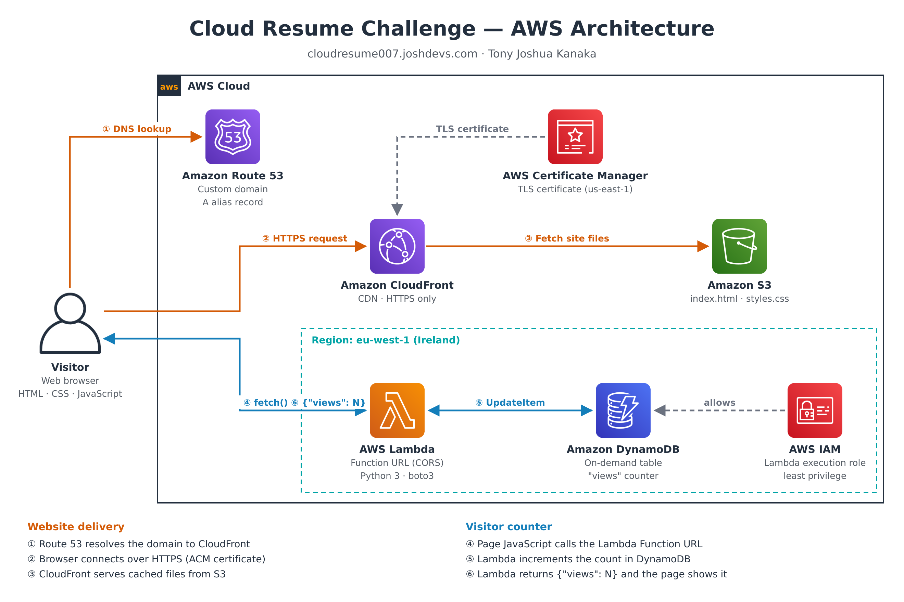

# ☁️ Cloud Resume Challenge — AWS

My resume as a serverless website on AWS, with a live visitor counter backed by DynamoDB.

**🔗 Live site:** https://cloudresume007.joshdevs.com


---

## 📌 About the project

The [Cloud Resume Challenge](https://cloudresumechallenge.dev/docs/the-challenge/aws/) is a hands-on project. You build and deploy your own resume website with real cloud services, from DNS and HTTPS to a serverless back end and a database.

This repository holds my implementation on AWS:

- a resume written in **HTML** and styled with **CSS**
- hosted as a static website on **Amazon S3**
- delivered globally over **HTTPS** through **Amazon CloudFront**, using a certificate from **AWS Certificate Manager (ACM)**
- served on a **custom domain** through **Amazon Route 53**
- a **visitor counter** in **JavaScript** that calls a **Python AWS Lambda** function, which stores the count in **Amazon DynamoDB**
- access controlled with an **IAM** role for the Lambda function
- the API tested with **Postman** before connecting it to the website

---

## 🏗️ Architecture




### Request flow

**Loading the website**
1. The visitor opens `cloudresume007.joshdevs.com`. **Route 53** resolves the domain to the **CloudFront** distribution through an alias record.
2. The browser connects to CloudFront over **HTTPS**, using the TLS certificate issued by **ACM**.
3. CloudFront serves `index.html` and `styles.css` from its edge cache, or fetches them from the **S3** bucket.

**Counting the visit**

4. When the page loads, the JavaScript calls the **Lambda Function URL** with `fetch()`.
5. The **Python (boto3)** Lambda function increments the `views` attribute in the **DynamoDB** table.
6. Lambda returns JSON such as `{"views": 16}`, and the page shows it in the footer.

---

## 🧰 Tech stack

| Layer | Service / tool | Purpose |
|---|---|---|
| Front end | HTML, CSS, JavaScript | Resume page and visitor counter |
| Hosting | Amazon S3 | Stores the static website files |
| CDN and HTTPS | Amazon CloudFront | Caches content worldwide and enforces HTTPS |
| SSL/TLS | AWS Certificate Manager | Free public certificate for the custom domain |
| DNS | Amazon Route 53 | Points the custom domain at CloudFront |
| API | AWS Lambda Function URL | HTTPS endpoint the browser calls |
| Back end | AWS Lambda (Python 3, boto3) | Reads and updates the visitor count |
| Database | Amazon DynamoDB (on-demand) | Stores the visitor count |
| Security | AWS IAM | Execution role with least-privilege DynamoDB access |
| API testing | Postman | Sends requests to the Lambda Function URL and checks the responses |

---

## 📂 Repository structure

```
cloud-resume-challenge/
├── frontend/
│   ├── index.html            # Resume page and visitor-counter script
│   └── styles.css            # Styling
├── backend/
│   └── lambda_function.py    # Python Lambda: increments and returns the count
├── docs/
│   └── architecture.png      # Architecture diagram (official AWS icons)
├── .gitignore
└── README.md
```

---

## 🚀 How I deployed it

### 1. Front end on S3
- Created an S3 bucket and uploaded `index.html` and `styles.css`.
- Kept the bucket private, with CloudFront as the only way in.

### 2. HTTPS with CloudFront and ACM
- Requested a public certificate in **ACM** (in **us-east-1**, which CloudFront requires) for `cloudresume007.joshdevs.com`, validated by DNS.
- Created a **CloudFront distribution** with the S3 bucket as origin, set the viewer protocol policy to *Redirect HTTP to HTTPS*, added the custom domain as an alternate domain name, and attached the ACM certificate.

### 3. Custom domain with Route 53
- Created an **A (alias) record** in Route 53 that points `cloudresume007.joshdevs.com` at the CloudFront distribution.

### 4. Database with DynamoDB
- Created a DynamoDB table in **on-demand** mode, with a single item that holds the `views` count.

### 5. API with Lambda
- Wrote a **Python** Lambda function using **boto3**. It increments `views` in DynamoDB and returns the new value as JSON.
- Gave the function an **IAM execution role** that can only read and update this table.
- Turned on a **Lambda Function URL** and configured **CORS** so the website's domain is allowed to call it.

### 6. API testing with Postman
Before connecting the API to the website, I tested the Lambda Function URL in **Postman**:
- Sent `GET` requests to the Function URL and checked for a `200 OK` status.
- Confirmed the response body is valid JSON in the expected format, for example `{"views": 16}`.
- Sent repeated requests to confirm the count goes up by one each time, which shows the DynamoDB update works.
- Checked the response headers while troubleshooting CORS.

Testing the API on its own first made it easy to tell back-end problems apart from front-end (JavaScript or CORS) problems.

### 7. Visitor counter in JavaScript
- Added a script to `index.html` that calls the Function URL on page load and writes the result into the footer.

### 8. Publishing updates
After changing the website:
```bash
aws s3 sync frontend/ s3://<your-bucket-name>/
aws cloudfront create-invalidation --distribution-id <your-distribution-id> --paths "/*"
```
The invalidation matters. Without it, CloudFront keeps serving the old cached version.

---

## 🐞 Challenges and what I learned

- **CORS:** the browser blocks calls to the Lambda URL unless CORS allows the site's domain. The `Access-Control-Allow-Origin` header has to be set in **one** place only, either the Function URL settings or the Lambda code. Setting it in both sends duplicate headers and the browser rejects the response.
- **Caching:** after uploading a new `index.html`, the site still showed the old page. A CloudFront invalidation plus a hard refresh (or an incognito window) fixed it.
- **ACM region:** certificates used by CloudFront must be requested in **us-east-1**, whatever region the rest of the stack is in.
- **DynamoDB number types:** boto3 returns numbers as `Decimal`, so the Lambda converts the value before returning it as JSON.

---

## 🗺️ Roadmap

Completed: **HTML, CSS, static website, HTTPS, DNS, JavaScript, database, API, Python.**

Next steps in the challenge:
- [ ] AWS Certified Cloud Practitioner certification
- [ ] Python unit tests for the Lambda function
- [ ] Infrastructure as Code with **Terraform** (or AWS SAM)
- [ ] CI/CD with **GitHub Actions**: test and deploy the back end and front end on every push, then invalidate CloudFront
- [ ] Blog post about the project

---

## 👤 Author

**Tony Joshua Kanaka**, Cloud Engineer and Cloud Support Engineer
📍 Limerick, Ireland
🔗 [LinkedIn](https://linkedin.com/in/tonyjoshua) · 🌐 [Resume website](https://cloudresume007.joshdevs.com)
